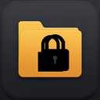

# SecretFolder

**Encrypted folder vault for Windows** — the feel of a local file explorer, with **secrets safe at rest**.

Use it for recovery codes, exports, screenshots of secrets, notes, and anything you would not trust to a plain folder or synced drive.

[](https://github.com/AhmiDarrow/SecretFolder/actions/workflows/ci.yml)
[](LICENSE)
[](https://github.com/AhmiDarrow/SecretFolder/releases)
[](#built-with-remedyui)

<p align="center">
  
</p>

<p align="center">
  <strong>Local-only · Master password · Folders + explorer · System tray</strong>
</p>

<p align="center">
  <strong>Built with <a href="#built-with-remedyui">RemedyUI</a></strong>: one Rust app, from the pixels to the crypto.
</p>

---

## Why

Plain folders and cloud drives are great for everyday files and terrible for secrets (readable on disk, backup sprawl, sync surface). **SecretFolder** keeps a familiar explorer UX and encrypts names and contents at rest.

Sibling product to [SecretSticky](https://github.com/AhmiDarrow/SecretSticky) (encrypted sticky notes): same crypto DNA and dark chrome, different job — **files**, not stickies. Separate app data, AAD namespace, identifier, and release channel; never share vaults or keys between the two.

## Built with RemedyUI

Since 1.0, SecretFolder runs on **RemedyUI**, Ahmi Darrow's own Rust UI engine. The explorer, the image preview, the tray, text rendering, accessibility and the signed updater all come from RemedyUI, so the whole app is one native Rust program:

- **No web view, no browser engine, no JavaScript** between you and your files. The 0.x releases were a Tauri and React app; 1.0 replaced all of it.
- **One language end to end**: the interface and the vault crypto live in the same Rust process, with the same memory handling (`zeroize`).
- **Same engine as [SecretSticky](https://github.com/AhmiDarrow/SecretSticky)** and [Alex's Craft Calc](https://github.com/AhmiDarrow/Alexs-Craft-Calc).

RemedyUI is not public yet.

## Features

| Area | Details |
|------|---------|
| **Vault** | Master password unlock; recovery key (shown once at setup) |
| **Crypto** | Argon2id (64 MiB, t=3) + XChaCha20-Poly1305 AEAD |
| **Keys** | Stable content key — change password without re-encrypting every blob or killing recovery |
| **Items** | Text notes, images, and binary files (v1 hard cap ~25 MiB per item) |
| **Names** | Filenames encrypted at rest |
| **Folders** | Nested groups, breadcrumbs, drag-move in-vault, drop OS files onto a folder |
| **Explorer** | List / search · text editor · image preview · import / export · multi-select |
| **Tray** | Show · Lock · Quit |
| **UX** | Close window → tray; Inter font (self-hosted); dark chrome + amber accent |
| **Clipboard** | Copy secrets with auto-clear (default 30s) |
| **Idle** | Auto-lock after inactivity (default 15 minutes) |
| **Updates** | Signed auto-update from GitHub Releases (About → Check for updates → Install & restart) |
| **About** | “Hi I'm Ahmi, hope this helps!” + profile / repo / releases / Patreon (opens system browser) |

## Install

### Prebuilt (recommended)

Download the latest Windows installer from  
**[Releases](https://github.com/AhmiDarrow/SecretFolder/releases/latest)**  
(`SecretFolder_<version>_x64-setup.exe`).

It is a per-user install (no administrator rights) with **Start Menu** and **Desktop** shortcuts. It takes over an earlier SecretFolder install (0.1.x and 0.2.0, including the MSI) and keeps your vault.

Installed builds can update themselves: **About → Check for updates**, then **Install & restart** downloads the next signed release from GitHub and relaunches the app.

### From source

SecretFolder 1.0 and later is the Rust app in `remedyui/`, built on RemedyUI. RemedyUI is not public yet, so building from source needs a checkout of it: `remedyui/Cargo.toml` finds it in a `Projects/RemedyUI` folder next to the `SecretFolder` folder.

```bash
cd SecretFolder/remedyui
cargo run --release
```

**Requirements:** Windows 10/11, Rust stable.

## Quick start

1. Launch SecretFolder → create a master password (12+ characters).
2. **Save the recovery key offline** (shown once). Lost password + lost recovery = permanent data loss.
3. Create folders, drop files in, or **New text**. Edit, preview images, export when needed.
4. Close the window with **X** → app stays in the tray. Tray → **Quit** to exit fully.
5. Tray → **Lock** when you step away.

## Data layout

```
%APPDATA%\com.ahmi.secretfolder\
  vault.json          # index + KDF params (encrypted names / metadata)
  vault.json.bak      # last-known-good sibling before each replace
  blobs\              # encrypted item payloads
```

- **Encrypted:** item names, content blobs  
- **Plaintext by design:** structural ids, kind, sizes, timestamps needed to list chrome without decrypting every payload early  

Durable save path: write + flush temp → snapshot `.bak` → atomic replace into `vault.json` (Windows uses `MoveFileExW` replace-in-place — never delete-then-rename). A crash mid-write must not leave you with zero copies of secrets.

**Non-negotiable product rule:** installing or auto-updating SecretFolder only replaces the application. Your vault stays under `%APPDATA%\com.ahmi.secretfolder\` and must remain unlockable with the same master password / recovery key after every update. App releases must not wipe files, rewrite ciphertext incompatibly, or ship changes that leave the vault permanently unreadable. Full invariant: [SECURITY.md](SECURITY.md).
## Security model

### Protects

- Vault files at rest (disk theft, backups, casual snooping)
- Authenticated encryption of item names and contents
- Idle lock + clipboard auto-clear for common desk-walk mistakes

### Does **not** protect

- Malware / keyloggers while unlocked  
- Screen capture of open previews/editors  
- A compromised OS or attached debugger  

There is **no cloud sync**, **no account**, and **no backdoor** for vault data.  
**Network use is limited to signed app updates** from GitHub Releases.

See [SECURITY.md](SECURITY.md) for the full threat model and vulnerability reporting.

## Development

```bash
cd remedyui
cargo test            # vault round trips with the shipped versions, every screen
cargo run             # the app
```

| Path | Role |
|------|------|
| `remedyui/` | The app (1.0+): unlock, explorer, settings, tray, updater, on RemedyUI |
| `remedyui/tests/fixtures/` | Vaults made by the shipped 0.1.0, 0.1.1, 0.1.5, 0.1.7 and 0.2.0 code, for round-trip tests |
| `src-tauri/src/crypto.rs`, `vault.rs` | Crypto and on-disk format, shared by the app |
| `src/`, `src-tauri/` | The Tauri app that shipped 0.1.x and 0.2.0 |
| `.github/workflows/` | CI, and signing of releases |

## CI & releases

- **CI** (`.github/workflows/ci.yml`) — on push/PR to `main`: frontend tests + Vite build, Rust fmt + tests (Windows).
- **Releases** — the Windows installer is built and tested locally with `cargo remedy package`, then uploaded to a draft release. The **Release** workflow (manual, with the tag) signs it with the updater key (repo secret `TAURI_SIGNING_PRIVATE_KEY`, the key every version since 0.1.2 trusts) and writes `latest.json`.

## Stack

- **Rust** + **RemedyUI** (windows, text, images, tray, accessibility, updates)
- **Crypto:** `argon2`, `chacha20poly1305`, `zeroize`
- **Font:** Inter, bundled
- **Updates:** minisign-signed GitHub Releases

## Auto-update

Release builds check GitHub Releases for updates:

1. The Release workflow signs the installer with a minisign key (`TAURI_SIGNING_PRIVATE_KEY` repo secret).
2. Each **published** (non-draft) release ships `latest.json` next to the installers.
3. The app polls `…/releases/latest/download/latest.json`, verifies the signature with the **public** key embedded in the binary, then installs (About → Check for updates → Install & restart).
4. Before install, the app **locks the vault** (drops session keys). The updater only replaces files under the install directory — **never** `%APPDATA%\com.ahmi.secretfolder`.

A `cargo run` build has no installer channel — use a packaged build to exercise updates.

Vault data never leaves the machine; only update checks hit GitHub. Draft GitHub releases break the `latest` channel — CI publishes releases non-draft.

## About

Hi I'm Ahmi, hope this helps!

- GitHub: [github.com/AhmiDarrow](https://github.com/AhmiDarrow)
- This project: [AhmiDarrow/SecretFolder](https://github.com/AhmiDarrow/SecretFolder)
- Sibling: [AhmiDarrow/SecretSticky](https://github.com/AhmiDarrow/SecretSticky)
- Releases: [github.com/AhmiDarrow/SecretFolder/releases](https://github.com/AhmiDarrow/SecretFolder/releases)
- Support: [patreon.com/cw/AhmiDarrow](https://www.patreon.com/cw/AhmiDarrow) — thank you!

SecretFolder is a small, local-first Windows app for people who need a real at-rest vault for files — text, images, and small binaries — without cloud accounts. Built with RemedyUI so the whole app, interface and crypto alike, is Rust.

## License

[MIT](LICENSE) © Ahmi Darrow
